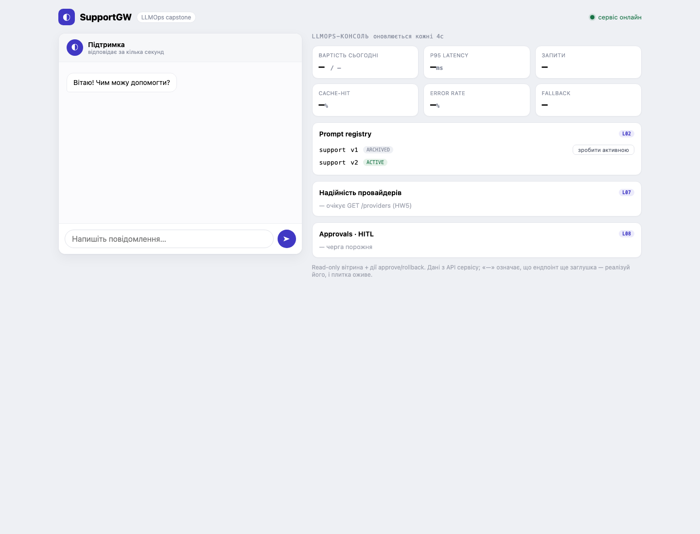

# HW1: логування та prompt registry

## Звідки береться лог

`POST /chat` у `service/Program.cs` генерує `request_id` та запам'ятовує час
початку. Модель береться з `MODEL` (за замовчуванням `mock`), токени — з `usage`
відповіді gateway, `status` — з HTTP-відповіді gateway (`0`, якщо відповіді
не було). `latency_ms` вимірюється до запису логу. `LogRequest` зберігає рядок
у `requests`, а `created_at` заповнює Postgres. Вартість поки `NULL` — це HW2.

## Рішення

`db/schema.sql` заводить промпт `support` з версіями `v1` і `v2`, активна `v2`.
Для кожного запиту сервіс читає текст та версію одним SELECT, тож у лог потрапляє
версія саме використаного тексту. За відсутності активного запису використовується
`You are an assistant.`, у лог пишеться `none`. Недоступність реєстру також
вмикає цей запасний промпт із попередженням у логах сервісу; якщо сама БД
недоступна, запис у `requests` неможливий, але чат може відповісти.

`GET /prompts` повертає масив `{name, version, active}`, який уже розуміє готова
консоль. `POST /prompts/{version}/activate` перемикає версії промпта `support`
у транзакції. Невідома версія повертає `404` без змін. Блокування таблиці
серіалізує перемикання, а частковий унікальний індекс забороняє дві активні
версії одного промпта, навіть при записі напряму в БД.

## Відтворення перевірок

Потрібні Docker Compose та Python 3. Реальні API-ключі не потрібні.

```sh
docker compose up --build -d
curl -sf http://localhost:8080/health
# Дочекайся готовності gateway (перший запит може бути повільним):
curl -sf http://localhost:4000/v1/chat/completions \
  -H 'Content-Type: application/json' \
  -d '{"model":"mock","messages":[{"role":"user","content":"hi"}]}'
python3 -m unittest discover -s tests -v
```

Для вже створеної БД новий seed застосовується лише після перестворення тому:
`docker compose down -v` **видаляє дані цього Compose-проєкту**. Використовуй
це лише для навчальної БД або запускай перевірки з новим `COMPOSE_PROJECT_NAME`
та вільними портами. Не застосовуй INSERT вручну: перевіряється саме SQL seed.

Тести змінюють активність промптів і додають рядки логу. Початковий стан має бути
`v2`; після перевірок відновлюється `v2`. Очікуваний результат: усі тести зелені,
при цьому вкладений eval для `v1` навмисно червоний (3/6, exit 1), для `v2` —
зелений (6/6, exit 0), поріг обох прогонів — 5.

Консоль: <http://localhost:4200>. Решта карток ще належить до наступних ДЗ.

## Результати перевірки (2026-11-03)

Перевірено після `docker compose down -v` та `docker compose up --build -d`
на окремому томі `my-bootcamp_pgdata`, створеному під час цієї роботи.
Усі п'ять контейнерів запущені. `python3 -m unittest discover -s tests -v`:
6 тестів, 0 помилок.

| Перевірка | Результат |
|---|---|
| SQL seed та `GET /prompts` | Два рядки, активна `v2` |
| Активація `v99` та SQL-подібного вводу | `404`, реєстр без змін |
| Rollback на `v1` | «не знаю», у логу `v1`, eval 3/6, exit 1 |
| Повернення на `v2` | Support-відповіді, у логу `v2`, eval 6/6, exit 0 |
| Усі промпти неактивні | «не знаю», у логу `none` |
| 16 паралельних активацій | Усі `200`, рівно одна активна версія |
| `__fail_503` | Запит залогований із `v2` та статусом `503` |
| UI через `/api/prompts` | Обидві версії видимі, `v2` активна |

Після тестів відновлено активну `v2`. Скриншот отримано з живого UI через
headless Chrome з окремим тимчасовим профілем.


