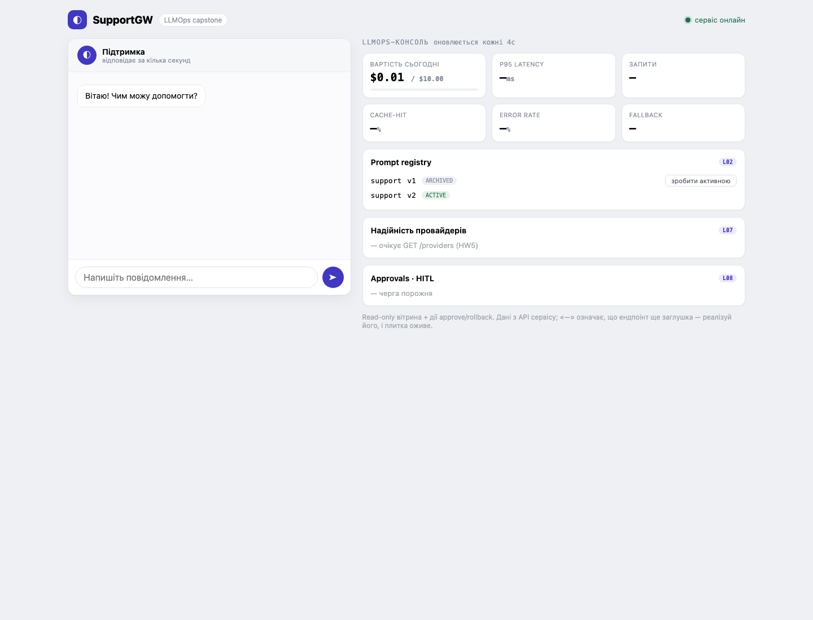

# HW2: routing та cost

Гілка HW2 створена від `main` після мержа HW1 (PR #1).

## Маршрути та тарифи

При `MODEL=mock` сервіс обирає модель за повідомленням, без урахування регістру:

- звичайні питання українською й англійською → `mock-mini`;
- маркери `поверн`, `скарг`, `термінов`, `refund`, `return`, `complain`, `urgent`
  → `mock-strong`. Основи слів також покривають «повернення», «скаргу»,
  «терміново», `complaint` і `complaining`.

Правила і таблиця цін живуть у `service/ModelPolicy.cs`.
Це **навчальні тарифи mock**, не ціни реальних провайдерів:

| Модель | USD / 1k input tokens | USD / 1k output tokens |
|---|---:|---:|
| `mock` (ручний режим) | 0.001 | 0.002 |
| `mock-mini` | 0.001 | 0.002 |
| `mock-strong` | 0.016 | 0.032 |

Для однакових token counts strong коштує рівно у 16 разів дорожче mini.
Для різних запитів питома ціна також залежить від співвідношення input/output.

Формула: `(prompt_tokens × input_rate + completion_tokens × output_rate) / 1000`.
Використовуються `usage` gateway та `decimal`; перед записом вартість округлюється
до 6 знаків, як `requests.cost_usd`. Помилка gateway без usage має нуль токенів
і нульову вартість; це не означає, що реальний провайдер ніколи не тарифікує
невдалі виклики.

Явний `MODEL=mock-mini` або `MODEL=mock-strong` лишає ручний вибір зі стартера.
Для реальної моделі потрібен актуальний тариф: невідомі моделі мають `cost_usd=NULL`
із попередженням у логах, щоб не видавати вигадану ціну за справжню.

Повний запасний порядок записано біля роутера:
`mock-strong → mock-mini → заглушка`, `mock-mini → mock-strong → заглушка`.
Виконання цього порядку належить до HW4.

## Денна вартість

`GET /cost` повертає числові `today_usd` та `budget_usd`. Сума читається щоразу
з Postgres за календарний день його часової зони, як `CURRENT_DATE` у критеріях.
Старі `NULL`-вартості HW1 не входять у суму; за відсутності вартостей повертається
0. Підсумок округлюється до 4 знаків, як SQL перевірки.

Бюджет за замовчуванням — USD 10, змінюється через `DAILY_BUDGET_USD`:

```sh
DAILY_BUDGET_USD=25 docker compose up -d service
```

Це значення для плитки, не автоматичне обмеження витрат. UI вже підтримує цей
контракт і показує суму до центів. `$0.00` на mock — очікувано для малих сум;
після багатьох запитів сума округлиться до `$0.01` або більше. Точніші значення
видно в API та SQL. Інші плитки належать до наступних ДЗ.

## Перевірка

```sh
docker compose up --build -d
# Якщо gateway щойно стартував, дочекайся успішного прогріву:
curl -sf http://localhost:4000/v1/chat/completions \
  -H 'Content-Type: application/json' \
  -d '{"model":"mock-mini","messages":[{"role":"user","content":"hi"}]}'
python3 -m unittest discover -s tests -v
curl -s http://localhost:8080/cost
docker compose exec -T postgres psql -U llmops -d llmops -c \
  'SELECT model, count(*) FROM requests GROUP BY model;'
docker compose exec -T postgres psql -U llmops -d llmops -c \
  'SELECT model, prompt_tokens, completion_tokens, cost_usd FROM requests WHERE cost_usd > 0 ORDER BY created_at DESC LIMIT 6;'
docker compose exec -T postgres psql -U llmops -d llmops -c \
  'SELECT round(SUM(cost_usd), 4) FROM requests WHERE created_at::date = CURRENT_DATE;'
python3 evals/run.py --dataset evals/golden.jsonl --threshold 5
```

Тести використовують `MODEL=mock` та бюджет 10. Як і раніше, вони додають реальні
рядки запитів і перемикають промпти, повертаючи активну `v2` після HW1. Тест дат
додає власні записи за вчора, сьогодні та завтра, після чого видаляє тільки їх
за UUID. Наявні логи і том БД зберігаються; міграція або скидання БД для HW2
не потрібні.

## Результати перевірки (2026-11-03)

| Критерій | Результат |
|---|---|
| Routing UK/EN | Звичайні питання → mini; повернення, скарги, терміновість → strong; великі літери враховано |
| Вартість у `requests` | Обидві моделі мають `cost_usd > 0`, точний розрахунок перевірений за usage |
| Ціна за модель | Тарифи input/output strong рівно 16× mini; у перевіреній парі питома ціна різниться приблизно у 15.7× |
| Fallback-порядок | Обидва повні ланцюги записані біля коду роутера |
| `/cost` | Повертає два числових поля; на контрольному зрізі `today_usd=0.0078`, `budget_usd=10` |
| Чесність суми | SQL `round(SUM(cost_usd),4)` та API дали однакові `0.0078`; записи інших дат виключені |
| Evals | На активній `v2` — 6/6, поріг 5; rollback на `v1` усе ще дає 3/6 та exit 1 |
| Регресії | Усі 12 інтеграційних тестів HW1+HW2 пройшли |
| Плитка вартості | Живе значення `$0.01 / $10.00` через `/api/cost`, UI не змінювався |

Додатково в окремих тимчасових контейнерах сервісу перевірено явний
`MODEL=mock-strong`: звичайне питання залоговано як strong з вартістю `0.000656`;
`DAILY_BUDGET_USD=25` повертає бюджет 25. Невідома тестова mock-модель отримала
помилку gateway `400` та чесний `cost_usd=NULL`. Контейнери після перевірки
зупинені й автоматично видалені; основний стек працює у звичайному режимі.
Ці додаткові варіанти конфігурації перевірені вручну, не входять у 12 автотестів.

Незалежне рев'ю коду не виявило критичних або суттєвих проблем.
Числа у зрізі зростатимуть після нових запитів; це не константи ендпоінта.


